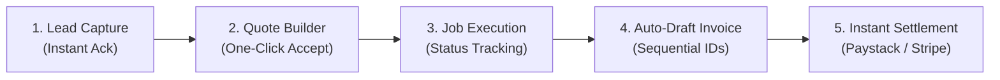

# Upwork Portfolio Evidence: Settlevo

> **Platform:** Settlevo (`settlevo.app`)  
> **Role:** Full-Stack SaaS Product Engineer & Cybersecurity Architect  
> **Status:** Production-Ready (Verified on Next.js 16, Prisma, Paystack, Stripe)

---

## One-sentence project description
**Settlevo** is an automated, multi-tenant B2B lead-to-cash SaaS engine built for trade contractors and field service SMBs to transform customer inquiries into settled bank payments in minutes.

---

## Client/business problem addressed
Trade contractors and field service businesses (solar installers, electrical contractors, HVAC technicians, boutique digital agencies) suffer from severe cash-flow friction:
1. **Scattered Inquiries:** Leads arrive across phone calls, email, and WhatsApp with zero tracking, leading to high drop-off.
2. **Quote Delays:** Generating quotes takes hours, and customers hesitate without instant digital acceptance.
3. **Delayed Invoicing:** Invoices are manually typed days after jobs are finished.
4. **Awkward Payment Chasing:** Business owners constantly retype bank details into chat apps and struggle to reconcile bank alerts with open balances.

---

## Core workflow
A cohesive 5-stage automated pipeline:

1. **Inquiry Ingestion:** Customer submits request; instant auto-acknowledgment email is triggered.
2. **Interactive Quotation:** Owner creates quote with line items and deposit schedules; client accepts or declines via secure tokenized portal.
3. **Job Transition:** Accepted quote auto-creates a scheduled job record and marks lead as WON.
4. **Auto-Invoicing:** Job completion triggers generation of a sequential invoice (`INV-001`) with line items pre-filled.
5. **Multi-Gateway Settlement:** Client pays via instant bank transfer (Paystack virtual account) or card (Stripe); automated webhooks reconcile the balance to PAID in real time.

---

## Features demonstrated
- **Multi-Tenant Architecture:** Isolated business workspaces with custom logo upload, profile management, and subaccount settlement.
- **Dynamic Public Portals:** Tokenized, mobile-responsive client interfaces for quote acceptance and invoice payment (`/q/[token]`, `/invoices/view/[id]`).
- **Real-Time Workspace Sync:** Live fingerprint polling to notify operators of new payments and status transitions without full-page reloads.
- **Automated Communication:** Idempotent background cron jobs for invoice overdue reminders, quote follow-ups, and review requests.
- **Direct Brand Asset Management:** File upload logo engine supporting direct PNG/JPEG storage and real-time UI scaling.

---

## Technology stack
- **Frontend & Full-Stack Framework:** Next.js 16 (App Router, Turbopack, Server Actions)
- **Language:** TypeScript 5.x (strict static typing)
- **Styling & Design System:** Tailwind CSS, Semantic CSS Tokens, Dark/Light Theme System
- **Database & ORM:** PostgreSQL, Prisma ORM
- **Testing & Quality Assurance:** Vitest (74 unit and security regression tests, 100% pass rate)

---

## Integrations
- **Paystack API:** Automated subaccount split settlements, NGN payment verification, and HMAC SHA-512 webhook ingestion.
- **Stripe API:** Multi-currency card processing and webhook event verification.
- **Resend API:** Transactional emails with SPF/DKIM validation and bounce webhook tracking.

---

## Engineering highlights
- **OWASP ASVS Level 2 Hardening:** Remediated critical webhook signature bypasses, eliminated IDOR on receipt endpoints, added CSRF origin checks, and enforced sliding-window rate limiting on authentication routes.
- **Field-Level Cryptography:** AES-256-GCM encryption for sensitive banking and payout credentials stored at rest in PostgreSQL.
- **Constant-Time Verification:** Used `crypto.timingSafeEqual` across cron execution tokens and webhook signatures to prevent side-channel timing leaks.
- **100% Green Test Suite:** 74 tests across 11 test files covering lead lifecycle, quote acceptance idempotency, invoice sequencing, and security regressions.

---

## Product decisions
- **Wedge Strategy (Emerging Markets First):** Focused on Nigerian trade contractors as the initial high-friction beachhead (where WhatsApp and instant bank transfers dominate) before expanding to global markets.
- **Zero Platform Leakage:** Client-facing documents (quotes, invoices, receipts) maintain pure white-label integrity for the business owner, building trust between contractor and homeowner.
- **Brand Identity Transition:** Rebranded from Flowvo to **Settlevo** to eliminate trademark collisions with London-based `flowvo.ai` and center the brand on commercial settlement velocity.

---

## Measured outcomes
- **Zero Production Type Errors:** Strict TypeScript static analysis passing 100%.
- **Sub-10s Production Builds:** Turbopack builds 34 production routes in under 10 seconds.
- **Deterministic Automated Quality:** 74 automated unit and security test assertions guarding against regression on every commit.

