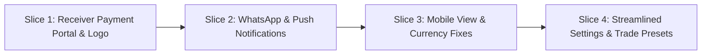

# 15. Flowvo — Field-Testing Enhancement Plan: Real Payments, Owner Notifications & Mobile-First UX

> **Status:** Draft for Review & Execution  
> **Author:** Antigravity (Oyebode Builder)  
> **Date:** 29 September 2026  
> **Trigger:** Real user feedback & field test findings:
> 1. Mobile view is difficult to use in the field.
> 2. Messaging via WhatsApp is vastly superior to email for trade/service clients.
> 3. Invoices lack business personalization and logo branding.
> 4. The business owner cannot stay inside the app 24/7 — they need instant alerts on **WhatsApp** and **Push Notifications** when a lead arrives, a quote is accepted, or an invoice is paid.
> 5. Currency symbols and amounts overlap/collide on inputs and cards (especially NGN, GH₵, KSh).
> 6. The payment flow is currently misplaced: it was tangled inside the controller/settings dashboard, rather than being a seamless, customer-facing checkout on the receiver's end.
> 7. Forms lack realistic trade presets and intuitive input helpers.

---

## 1. Problem Framing & Core Architecture Decisions

### The Two Major Inversions in the Current Code

#### Inversion 1: The Payment Flow Was in the Wrong Place
* **Current Flaw:**
  The invoice detail page (`/invoices/[id]`) and printable page (`/invoices/[id]/print`) require an authenticated business owner session (`getCurrentSession()`). When an external customer opens an invoice or returns from Paystack/Stripe, **they are redirected to `/login`**.
  Meanwhile, in Settings (`BusinessProfileForm.tsx`), the owner is overwhelmed by raw API secret keys, test connection buttons, and developer subaccount forms.
* **The Correct Flow (The Receiver End):**
  - **The Customer's Public Portal (`/inv/[id]` or `/invoices/view/[id]`):**
    - 100% accessible to customers **without requiring any login**.
    - Displays the business's **real logo**, contact details, and itemized charges.
    - **Dual Payment Choices in One Place:**
      1. **Online Payment (Paystack / Stripe):** Instant card, USSD, Apple Pay, or direct bank debit.
      2. **Direct Bank Transfer:** Displays the business's verified Bank Name, Account Number (with a 1-click **Copy Account Number** button), and Verified Account Name.
    - **"Confirm Payment on WhatsApp":** A 1-tap button for the customer to message the merchant immediately with payment proof.
    - **Instant Receipt & PDF Download:** Post-payment receipt with transaction reference.
  - **The Owner's Settings (The Controller End):**
    - Streamlined:
      1. Bank Account (Select Bank, enter 10-digit NUBAN — auto-verified).
      2. Toggle "Accept Online Card Payments".
      3. Upload Business Logo.
      4. Enter WhatsApp number for instant owner notifications.

#### Inversion 2: The Owner Does Not Live Inside the App
* **Current Flaw:**
  The platform only sends Resend emails to customers and writes internal `ActivityLog` rows. If an owner is on a job site, climbing a ladder, or driving, they have zero idea that a customer accepted a quote or paid an invoice until they log back into the web app hours later.
* **The Correct Flow (Owner-Centric Alerts):**
  1. **Owner WhatsApp Alerts:**
     - The owner registers their personal WhatsApp number in Settings.
     - When high-intent events occur:
       - **Lead Enquired:** *"🚨 New Lead: [Name] enquired about [Service]. Phone: [Phone]. View: [Link]"*
       - **Quote Accepted:** *"🎉 Quote Accepted: [Name] accepted Quote #[Q-001] for ₦150,000! Job auto-scheduled. View: [Link]"*
       - **Payment Received:** *"💰 Payment Received: [Name] paid Invoice #[INV-001] (₦150,000)! View receipt: [Link]"*
     - Sent via automated dispatch (webhook/WhatsApp Cloud API/Twilio/Termii) + customer 1-tap WhatsApp confirmation bridge.
  2. **Native Web Push Notifications:**
     - Browser Web Push (Service Worker + VAPID) delivers lock-screen notifications to the owner's phone (Android, iOS 16.4+, Chrome, Safari, Edge) even when the browser is closed.
  3. **In-App Notification Center:**
     - Bell icon in the top header with an unread badge and dropdown feed for when the owner opens the app.

---

## 2. Delivery Slices



### Slice 1: The Receiver-End Public Invoice & Payment Portal
* **Public Route:** Create `/invoices/view/[id]` (publicly accessible, no session guard).
* **Business Branding & Logo:** Add `logoUrl` to `Business` model in Prisma. Display the business logo prominently on the invoice header, print page, and quote page.
* **Integrated Online Checkout:**
  - Embed Paystack Inline Checkout / Stripe Checkout directly on the customer's invoice page.
  - Fix Paystack/Stripe return callback URL to point to `/invoices/view/[id]?paid=true` so customers see their confirmed receipt immediately.
* **Direct Bank Transfer Card:**
  - Bank Name (e.g. *Guaranty Trust Bank*), Account Number (with 1-click **Copy** button), and Verified Account Name.
* **Customer WhatsApp Action:**
  - *"I have transferred — Confirm on WhatsApp"* button that opens WhatsApp with pre-filled payment confirmation text to the merchant.
* **Print / PDF Receipt:** Make `/invoices/[id]/print` accessible via public token/view so customers can save/print their official receipt without logging in.

### Slice 2: Owner Notifications (WhatsApp + Web Push + In-App)
* **Owner WhatsApp Alerts:**
  - Add `notificationPhone` to `Business` model.
  - Implement notification dispatch utility (`src/lib/notifications.ts`):
    - Triggers on: Lead Created, Quote Accepted, Invoice Paid, Review Submitted.
    - Formats concise, actionable WhatsApp alerts with direct links back to the app.
* **Web Push Notifications:**
  - Add Service Worker (`public/sw.js`) and Push Notification subscription API (`/api/notifications/subscribe`).
  - Send lock-screen push alerts using web-push when payments or accepted quotes occur.
* **In-App Notification Center:**
  - Add notification bell to `AppShell` header with unread badge counter.
  - Dropdown showing recent activity feed (clickable to jump directly to the relevant Lead, Quote, or Invoice).

### Slice 3: WhatsApp-First Customer Messaging & Mobile Layout
* **1-Click "Send on WhatsApp" for Quotes & Invoices:**
  - On Quote Detail and Invoice Detail, add a primary green **"Send via WhatsApp"** button.
  - Formats phone numbers automatically (`080...` -> `+23480...`, `07...` -> `+447...`).
  - Pre-fills professional message with customer name, total due, and direct public link (`/q/[token]` or `/invoices/view/[id]`).
* **Mobile View Overhaul:**
  - Bottom navigation bar: 5 thumb-friendly tabs (Home, Leads, Quotes, Jobs, Invoices).
  - Quote Editor: Convert horizontal multi-column table into mobile-responsive card inputs.
  - Touch target sizing (minimum 44px) and numeric keypad optimization (`inputMode="decimal"`).
* **Fix Currency Overlapping:**
  - Fix `QuotesPage` hardcoded `formatPence` (always £) -> use dynamic `formatAmount(total, currency)`.
  - Replace absolute-positioned input overlays with CSS flex input groups (`[ ₦ ] [ 150,000 ]`).
  - Add commas to monetary inputs and prevent badge collision with `min-w-0` and `flex-wrap`.

### Slice 4: Streamlined Controller Settings & Real User Presets
* **Clean Controller Settings:**
  - Group settings into clean, intuitive sections:
    1. **Business Profile & Logo:** Name, Phone, Email, Address, Logo Upload / URL.
    2. **Payout Bank Account:** Select Bank, 10-digit NUBAN, instant account name lookup.
    3. **Online Payments:** Single toggle to enable/disable card & online transfers.
    4. **Notifications:** Owner WhatsApp number & Push notification toggle.
* **Real Trade Presets in Quote Editor:**
  - Add quick-insert templates for common trades (Plumbing, Electrical, Solar/Inverter, HVAC, Cleaning, Painting, Carpentry).
  - One click populates standard descriptions, quantities, and realistic rates.

---

## 3. Database Schema Changes

```prisma
// Additions to Business model:
model Business {
  // ... existing fields ...
  logoUrl            String?   // URL or Base64 of business logo
  notificationPhone  String?   // Owner WhatsApp number for instant event alerts
  pushSubscriptions  String?   // JSON array of Web Push subscriptions
}

// Additions to Invoice model:
model Invoice {
  // ... existing fields ...
  viewToken          String?   @unique @default(cuid()) // Secure public viewing token
}
```

---

## 4. Verification & Testing Standards

1. **Receiver Payment Flow Test:**
   - Open `/invoices/view/[id]` in an incognito window (no login session).
   - Verify logo, items, currency symbol (`₦` for NGN, `£` for GBP, `$` for USD).
   - Click "Copy Account Number" -> verify clipboard.
   - Click "Pay Online" -> verify checkout trigger.
   - Verify post-payment redirect lands on confirmed receipt, NOT `/login`.
2. **Owner Notification Test:**
   - Simulate customer quote acceptance -> verify owner WhatsApp alert payload & push notification.
   - Simulate invoice payment -> verify instant lock-screen push and in-app bell update.
3. **WhatsApp Sharing Test:**
   - Click "Send via WhatsApp" on Quote & Invoice -> verify pre-filled URL and message encoding.
4. **Mobile & Currency Test:**
   - Test on 375px mobile viewport -> verify bottom navigation, zero horizontal scrolling.
   - Enter `2,500,000` NGN in Quote Editor -> verify symbol and numbers never collide.
