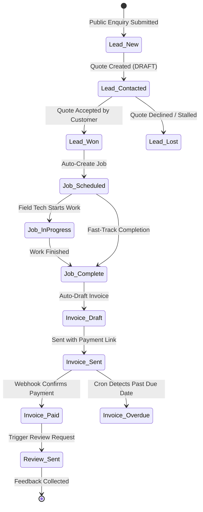

# Settlevo (Flowvo) — System Architecture & Technical Specification

> **Classification:** Production Architecture & Engineering Specification  
> **Author:** Oyebode Precious Isaac — Lead Systems Architect & Full-Stack Engineer  
> **Platform Version:** 1.0.0 (Production Release)  
> **Target Industry:** Trade Contractors, Field Technicians & Service SMBs  

---

## 1. Executive System Overview

**Settlevo** (internally known as **Flowvo**) is an autonomous Lead-to-Cash operational engine designed to eliminate the administrative overhead and revenue leakage experienced by trade and service micro-businesses (plumbing, electrical, HVAC, tiling, finishing).

Traditional service businesses lose an estimated 20% to 40% of their revenue at transaction boundaries:
- Enquiries sit unanswered while tradespeople are on site.
- Quotes are sent informally via chat and forgotten.
- Completed jobs languish for weeks before an invoice is issued.
- Payment collection relies on manual, error-prone bank transfer reconciliation.
- Google review requests are rarely collected systematically.

Settlevo closes these gaps with an automated, state-machine-driven pipeline:
$$\text{Public Enquiry} \longrightarrow \text{Qualified Lead} \longrightarrow \text{Interactive Quote} \longrightarrow \text{Scheduled Job} \longrightarrow \text{Auto-Draft Invoice} \longrightarrow \text{Direct Settlement} \longrightarrow \text{Reputation Loop}$$

---

## 2. High-Level Architecture

```
+-----------------------------------------------------------------------------------------+
|                                    SETTLEVO ARCHITECTURE                                |
+-----------------------------------------------------------------------------------------+
|  CLIENT & PUBLIC SURFACES                                                               |
|  +------------------------+  +------------------------+  +---------------------------+  |
|  | Public Enquiry Portal  |  | Customer Portal        |  | Operator Dashboard (App)  |  |
|  | /enquiry/[slug]        |  | /q/[token], /invoices  |  | (Authenticated App Shell) |  |
|  +-----------+------------+  +-----------+------------+  +-------------+-------------+  |
+--------------|---------------------------|-----------------------------|----------------+
               | HTTPS                     | HTTPS                       | HTTPS
+--------------v---------------------------v-----------------------------v----------------+
|  EDGE ROUTING & APPLICATION LAYER (Next.js 16 App Router + React 19)                    |
|  +------------------------------------------------------------------------------------+ |
|  | Security Middleware: Nonce Injection, CSP Headers, Origin Guard, Rate Limiting     | |
|  +------------------------------------------------------------------------------------+ |
|  | Route Handlers & Server Actions:                                                   | |
|  |  * Lead Intake & Validation Engine    * Dynamic Quote & Margin Computation         | |
|  |  * Dual Payment Rails (Paystack/Stripe) * Autonomous Cron Background Workers       | |
|  |  * Bank NUBAN Account Resolver        * Resend Transactional Email Engine          | |
|  +------------------------------------------------------------------------------------+ |
+--------------|---------------------------------------------------------|----------------+
               | Prisma Queries                                          | Webhooks
+--------------v---------------------------------+  +--------------------v----------------+
|  DATA & PERSISTENCE LAYER                      |  | EXTERNAL INTEGRATIONS ENGINE        |
|  +-------------------------------------------+ |  | +---------------------------------+ |
|  | PostgreSQL (Neon Serverless / Supabase)   | |  | | Paystack API (Subaccounts, NGN) | |
|  | - User, Session & BusinessProfile         | |  | | Stripe API (Checkout, Multicur.)| |
|  | - Lead & ActivityLog                      | |  | | Resend API (Transactional Mail) | |
|  | - Quote, QuoteItem & Job                  | |  | | Google Places Review Gateway    | |
|  | - Invoice, PaymentRecord & ReviewRequest  | |  +---------------------------------+ |
|  +-------------------------------------------+ |                                        |
|  | AES-256-GCM Bank Details Encryption Vault | |                                        |
+------------------------------------------------+----------------------------------------+
```

---

## 3. The 5-Stage Operational State Machine

Settlevo coordinates the entire business lifecycle through deterministic database state transitions.



### Stage 1: Inbound Lead Capture & Instant Acknowledgment
- **Public URL**: `/enquiry/[businessSlug]`
- Branded intake form with anti-spam honeypot and client-side Zod validation.
- Automatically persists a `Lead` with status `NEW`.
- Asynchronously triggers an immediate customer acknowledgment email (*"We have received your enquiry and are reviewing the details"*).
- Dispatches an operator alert with direct link to generate an estimate.

### Stage 2: Interactive Quotation Engine
- Operators configure quote line items, labor, materials, and optional tax/discount rates.
- Generates a unique, high-entropy tokenized URL (`/q/[quoteToken]`).
- The customer receives an email and can inspect, accept, or decline the quote on any mobile or desktop device without creating an account.

### Stage 3: Zero-Friction Quote Acceptance to Job Conversion
- Customer acceptance is recorded with digital signature text and timestamp.
- Atomic database transaction transitions `Quote` to `ACCEPTED` and `Lead` to `WON`.
- **Automatic Provisioning**: Automatically instantiates a `Job` record with copied scope, line items, and customer references.

### Stage 4: Field Execution & Auto-Draft Invoicing
- Field operators transition the job status (`SCHEDULED` $\rightarrow$ `IN_PROGRESS` $\rightarrow$ `COMPLETE`).
- Upon marking a job as `COMPLETE`, Settlevo immediately auto-drafts an `Invoice` with:
  - Sequential invoice number (`INV-001`, `INV-002`, etc.) per business tenant.
  - Mirrored line items, quantities, and pricing from the accepted job.
  - Zero manual data re-entry required.

### Stage 5: Dual Payment Rails & Reputation Engine
- **Paystack Rail (Nigeria)**: Direct NGN payments via debit card or dynamic virtual bank accounts. Settles directly into the artisan's local bank account using Paystack Subaccounts.
- **Stripe Rail (International)**: Multi-currency checkout (GBP, USD, EUR) with Apple Pay and Google Pay support.
- **Webhook Handshake**: Payment triggers an idempotent database transition to `PAID`.
- **Review Trigger**: Once paid, Settlevo automatically queues a Google Review Request email directing happy customers to the operator's Google Business Profile.

---

## 4. Multi-Tenant Security & Isolation

1. **Query-Level Scoping**: Every business entity (`Lead`, `Quote`, `Job`, `Invoice`, `ActivityLog`) is foreign-keyed to `businessId`. All authenticated dashboard endpoints enforce `where: { id, businessId: session.user.businessId }`.
2. **Encrypted Storage**: Trade artisan bank account credentials (NUBAN account numbers, bank codes, subaccount IDs) are encrypted at rest using **AES-256-GCM** before database persistence.
3. **Timing-Safe HMAC Verification**: All incoming webhooks from Paystack, Stripe, and Resend require strict signature verification using timing-safe buffer comparisons (`crypto.timingSafeEqual`).
4. **Token Entropy**: Public-facing customer tokens (`quoteToken`, `sessionToken`, `passwordResetToken`) utilize 256 bits of cryptographic entropy (`crypto.randomBytes(32)`).

---

## 5. Live State Synchronization (SSE & Polling)

Settlevo implements a lightweight live-sync abstraction combining Server-Sent Events (SSE) with an intelligent fallback polling mechanism:
- Route: `/api/live/status`
- Computes a state fingerprint based on open leads, active jobs, and pending invoices.
- Minimizes database round-trips while delivering real-time notification badge counts and dashboard metric refreshes without external socket server overhead.
